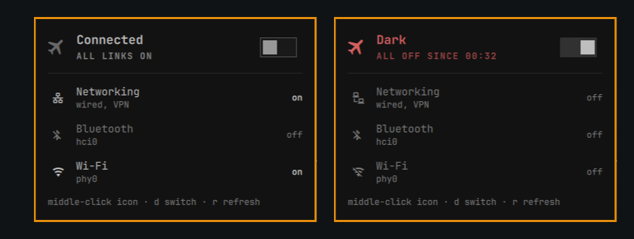

# GoDark

One switch on the Omarchy bar. Click it, and every radio and network link
on the machine goes off: wifi, bluetooth, mobile, ethernet, all of it.
Click it again, and exactly what was on before comes back. Nothing more:
if bluetooth was off before, it stays off.

---

Needs Omarchy 4.x and NetworkManager. Nothing else: it uses `rfkill` and
`nmcli`, which are already there.

## Install

```bash
omarchy plugin add https://github.com/SalimRK/godark.git --enable
```

There's no setup step, no polkit rule, no sudo, and nothing installed
system-wide.

## Using it

<p align="center">
  
</p>

- **Middle-click** the icon: go dark / restore, right away.
- **Left-click**: open the panel. It shows the state, an on/off switch
  (on = dark), and every link: networking, Wi-Fi, Bluetooth, and any other
  radio. A link still on while you're dark turns red. `d` or space flips
  the switch, `r` refreshes.

The icon only shows real state:

| Icon | Meaning |
|---|---|
| dim | connected, normal |
| red | dark: networking off and every radio off |
| bright | partly back on, e.g. wifi turned on by hand while dark. Click to cut it again |

## What it cuts

- **Every radio `rfkill` knows about**: wlan, bluetooth, wwan, nfc, gps,
  uwb. Each one is soft-blocked.
- **All NetworkManager networking** (`nmcli networking off`). That covers
  ethernet, USB tethering, NM VPNs, and anything else NM runs.

An interface NetworkManager doesn't manage can't be cut without root, so
GoDark doesn't try. It shows up in red in the panel and in `godark status`
instead, so you're never told you're dark when you aren't.

**GPS**: a GPS inside a mobile-data modem goes off with the `wwan`
block. A USB GPS dongle has no switch GoDark can reach and stays on.
GPS only receives, so nothing leaks while you're dark, but an app could
record your position and send it after you restore.
Unplug it if that matters.

A radio held off by a **hardware switch** is shown as such. GoDark counts
it as dark, but can't turn it back on for you.

## Restoring

Before cutting anything, GoDark saves what was on to
`~/.local/state/godark/state`. Restore puts back exactly that, then
deletes the file.

**Dark survives a reboot.** systemd and NetworkManager both remember the
state, so the machine comes back dark, and the saved state is still there
to restore from. A reboot won't quietly reconnect you.

If the saved state is missing while the machine is dark, restore turns on
networking, wifi and mobile only, and leaves bluetooth and the other
radios off. Turn those on yourself if you want them.

## Privileges

None. Radios go through `rfkill`, which systemd's stock rules let your
active session use. Networking goes through NetworkManager, whose stock
policy lets your active session switch it. Neither works over ssh or from
an inactive session; GoDark then fails with the tool's error. Never run
`godark` with `sudo`; it refuses.

## Commands

| | |
|---|---|
| `godark status [--json]` | dark / partial / light, every radio, networking |
| `godark dark` | save what's on, then cut it all |
| `godark light` | put back exactly what was saved |
| `godark toggle` | dark if not dark, otherwise light |

If you're dark and the bar is gone, the CLI still works:

```bash
~/.config/omarchy/plugins/oniomarchy.godark/godark light
```

## Removing it

```bash
~/.config/omarchy/plugins/oniomarchy.godark/godark light
omarchy plugin remove oniomarchy.godark
rm -rf ~/.local/state/godark
```

## License

MIT
